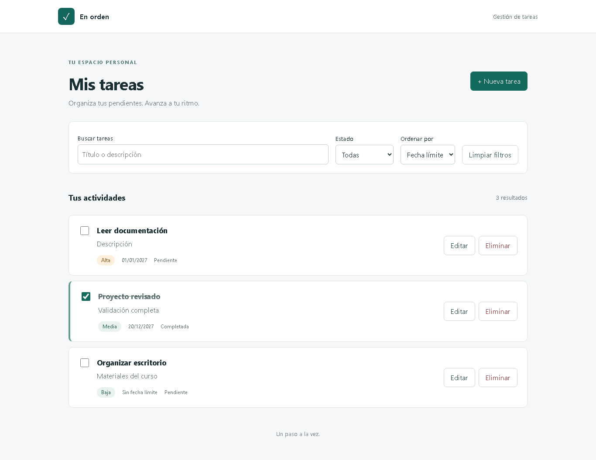
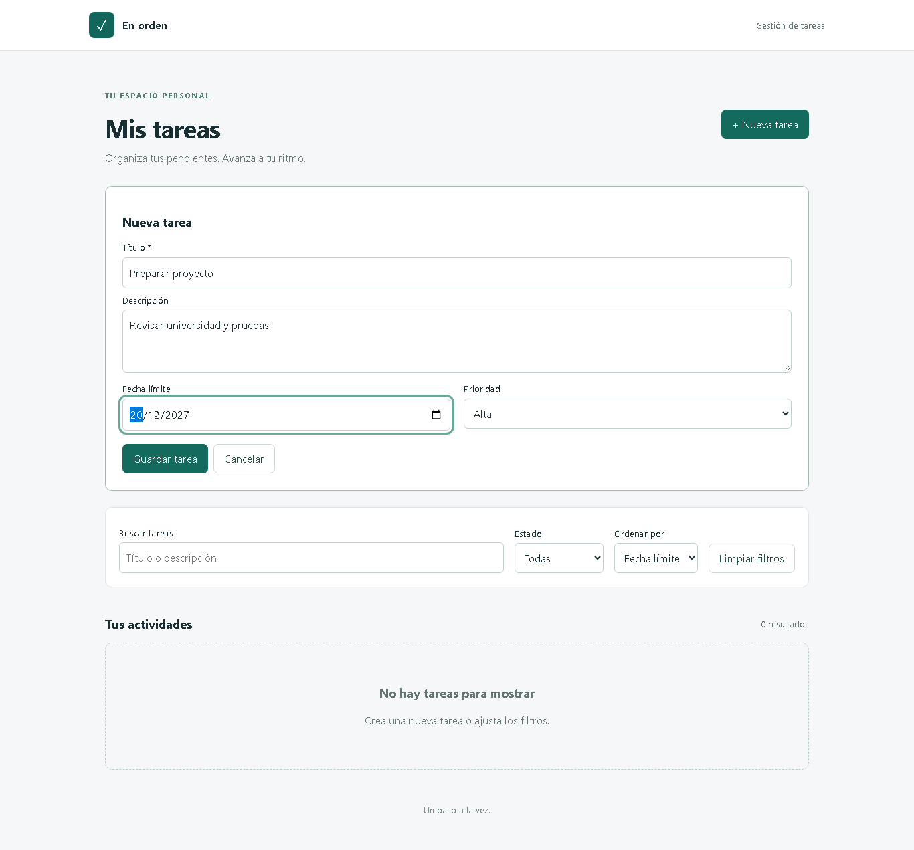

# En orden — Gestión de tareas personales

Angular y ASP.NET Core con MongoDB para organizar tareas. Implementación del enunciado de Parcial I de Programación VI, con asistencia de IA declarada. No se ha presentado en Moodle ni se presume autorización docente para rendir una evaluación con IA.

## Requisitos

.NET SDK 10.0.301, Node.js 22.13.1 (o versión compatible con Angular 21), npm y MongoDB Community 8.0.34 o Atlas. No requiere Docker ni Angular CLI global. Versiones npm fijadas mediante package-lock.json. Backend: MongoDB.Driver 3.13.0, Scalar.AspNetCore 2.18.7, OpenAPI 10.0.14.

## Ejecutar desde cero

Desde la raíz en PowerShell:

```powershell
dotnet restore
npm.cmd ci --prefix frontend
npm.cmd ci
New-Item -ItemType Directory -Force .local/demo-db
& 'C:\ruta\mongodb\bin\mongod.exe' --dbpath .local/demo-db --port 27027 --bind_ip 127.0.0.1
```

En otra terminal, desde la raíz:

```powershell
$env:ASPNETCORE_ENVIRONMENT='Development'
$env:Mongo__Uri='mongodb://127.0.0.1:27027'
$env:Mongo__Database='ParcialITareas'
dotnet run --project backend --no-launch-profile -- --seed
dotnet run --project backend --no-launch-profile -- --urls http://127.0.0.1:5095
```

En una tercera terminal:

```powershell
npm.cmd start --prefix frontend -- --host 127.0.0.1 --port 4205 --proxy-config proxy.conf.json
```

Frontend: http://127.0.0.1:4205. API: http://127.0.0.1:5095/api/tareas. Scalar: http://127.0.0.1:5095/scalar. OpenAPI: http://127.0.0.1:5095/openapi/v1.json. Documentación habilitada en Development. El proxy Angular evita la necesidad de CORS abierto.

La carga demo es explícita, usa tres ObjectId fijos y SetOnInsert; repetirla no duplica datos ni reemplaza ediciones.

### Atlas y secretos

Configurar `Mongo:Uri` mediante .NET User Secrets o `Mongo__Uri` en el entorno. Usar `Mongo:Database`/`Mongo__Database` igual a `ParcialITareas`; colección `Tareas`. Autorizar solo la IP necesaria. Nunca guardar URI privada en Git. Las variables de entorno prevalecen sobre User Secrets: los comandos locales anteriores funcionan aun con Atlas configurado. El clúster previo se reutiliza en una base separada de VentasAcademicas.

## Estructura

- `backend/Controllers`: cinco operaciones CRUD y LINQ.
- `backend/Models`, `DTOs`, `Services`: BSON, validación y colección.
- `frontend/src/app`: AppComponent, TaskListComponent, TaskFormComponent y servicio HTTP.
- `tests/unit`: validación, fechas, BSON y reglas de actualización.
- `tests/e2e`: integración HTTP/MongoDB y Chromium real.
- `scripts/Verificar.ps1`: batería reproducible.
- `evidencias`, `REQUISITOS.md`, `PROGRESO.md`: resultados y trazabilidad.

## API

| Método | Ruta | Respuesta |
|---|---|---|
| GET | `/api/tareas` | 200, lista filtrada |
| GET | `/api/tareas/{id}` | 200 o 404 |
| POST | `/api/tareas` | 201 y Location |
| PUT | `/api/tareas/{id}` | 200 o 404 |
| DELETE | `/api/tareas/{id}` | 204 o 404 |

```json
{"titulo":"Repasar LINQ","descripcion":"Preparar ejemplos","fechaLimite":"2027-12-20","prioridad":3,"completada":false}
```

Ejemplo: `/api/tareas?estado=pendiente&buscar=universidad&ordenarPor=prioridad`. Estado: pendiente/completada o vacío. Búsqueda por título o descripción sin distinguir mayúsculas. Prioridad: alta 3, media 2, baja 1, orden descendente. Fecha: ascendente, nulas al final; desempate estable por Id. LINQ se ejecuta en MongoDB antes de materializar.

Títulos obligatorios (máximo 120), descripción hasta 2000, prioridad 1–3 y fecha civil válida. Fechas pasadas admitidas para registrar tareas vencidas. Fecha límite se almacena a medianoche UTC y se muestra en UTC. Marcas internas con precisión BSON de milisegundos. Campos internos no editables; propiedades desconocidas, filtros e identificadores inválidos devuelven 400. Errores inesperados usan Problem Details.

## Pruebas

Con los puertos 27027, 5095 y 4205 libres:

```powershell
./scripts/Verificar.ps1 -MongodPath 'C:\ruta\mongodb\bin\mongod.exe'
```

Instala dependencias, compila, ejecuta unitarias e integración/E2E. Inicia servicios propios y utiliza exclusivamente la base temporal `ParcialI_Automated`, limpiada al inicio y final. No usar una instancia compartida en el puerto de pruebas. Detiene sus procesos al finalizar.

Ejecución focalizada tras instalar:

```powershell
dotnet test -c Release
$env:MONGOD_PATH='C:\ruta\mongodb\bin\mongod.exe'
npm.cmd test
```

La batería comprueba códigos HTTP, CRUD, BSON, filtros combinados, orden exacto, formularios, cancelar/confirmar borrado, error de red y recuperación. Ejecuta el ciclo completo a 375×812, 768×1024 y 1366×768; lee MongoDB directamente y reinicia el backend para comprobar persistencia. El único interceptado de red aborta solicitudes para simular indisponibilidad: no fabrica respuestas satisfactorias.

## Capturas auténticas





Verificación final: 6 unitarias y 5 escenarios integración/E2E aprobados, cinco comprobaciones Atlas y carga demo idempotente. Resumen público en evidencias/resultados.json; reporte detallado playwright.json y TRX conservados localmente. Repositorio: https://github.com/Matias2710/parcial-i-programacion-vi-tareas.

## Alcance y referencias

Aplicación personal en loopback, sin autenticación multiusuario ni paginación masiva. Documento académico: MongoDB 3%, API 5%, Angular 7%. Portada contradictoria: III cuatrimestre 2026 y fecha 26/06/2025. No se infiere fecha vigente. No exige PDF adicional. Material docente y credenciales no se publican.

- [Compatibilidad Angular](https://angular.dev/reference/versions).
- [Scalar ASP.NET Core](https://scalar.com/docs-for/dotnet).
- [LINQ MongoDB](https://www.mongodb.com/docs/drivers/csharp/current/aggregation/linq/).
- [Playwright](https://playwright.dev/docs/intro).

